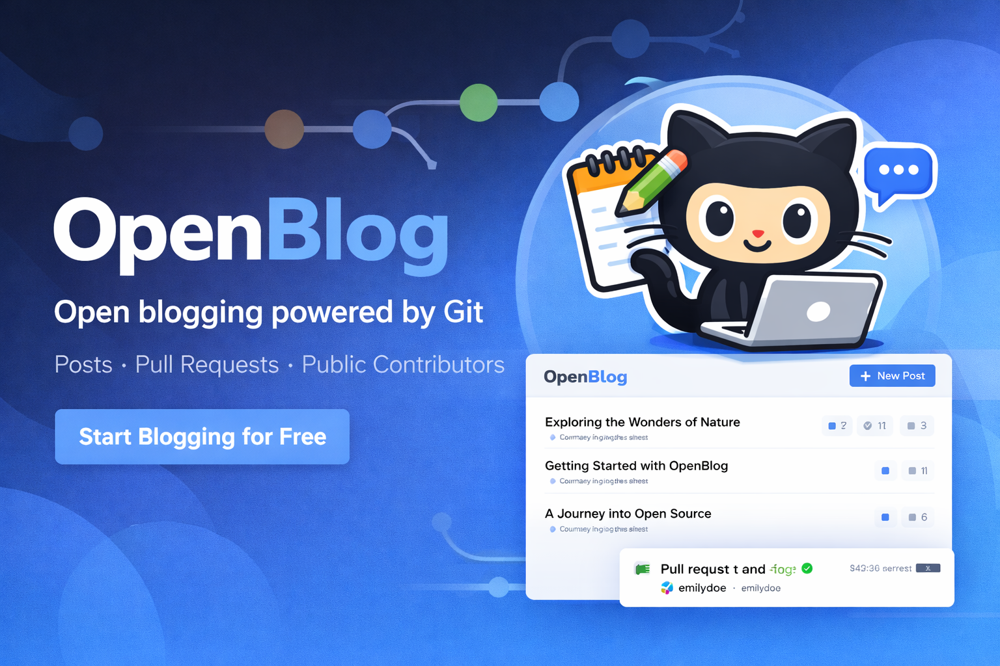

# OpenBlog



[](https://github.com/hajiparvaneh/openblog)
[](https://github.com/hajiparvaneh/openblog/pulls)
[](https://astro.build/)
[](https://nodejs.org/)
[](LICENSE)

Live community site: [https://openblog.cc](https://openblog.cc)

OpenBlog is two things in one repository:

1. **Starter (default)** — a Material-for-MkDocs-style Markdown blog you can brand and host on GitHub Pages with no secrets.
2. **Community app (opt-in)** — the collaborative publication at openblog.cc with PR scoring and a public leaderboard.

## Quickstart (start your own blog)

Target: template → branded preview → first Markdown PR → live URL in under 10 minutes.

### 1. Create a repo from this template

On GitHub: **Use this template** (enable Template repository in Settings if you maintain the upstream).  
Or clone this repo and push it to a new empty repository.

### 2. Preview locally

```bash
npm install
npm run dev
```

Requirements: Node.js 22.12+.

### 3. Brand the site

Edit `openblog.config.ts`:

- `title`, `description`
- `nav`, `footerText`, `accentColor`, `defaultTheme`
- logo / favicon / OG paths (defaults point at `public/branding/`)

Replace files under `public/branding/` (see that folder’s README).  
Edit the About page at `content/about.md`.

You should not need to edit Astro layouts for a normal personal blog.

### 4. Write a post

Add or edit:

`content/posts/<category>/<post>.md`

Two starter samples live under `content/posts/getting-started/`. Keep or delete them.

```md
---
title: My post
description: One-line summary.
date: 2026-11-03
tags: [notes]
---

Write in Markdown.
```

### 5. Enable GitHub Pages

1. Repo **Settings → Pages → Build and deployment → GitHub Actions**.
2. Push to `main` (the `Deploy GitHub Pages` workflow builds the starter when `OPENBLOG_COMMUNITY` is not `true`).
3. Default publish URL: `https://<user>.github.io/<repo>/`.

**Project site (default in CI):** `OPENBLOG_BASE_URL=https://<user>.github.io/` + `OPENBLOG_BASE_PATH=/<repo>`.  
**Custom domain or root site:** set repository variables:

| Variable | Example |
| --- | --- |
| `OPENBLOG_BASE_URL` | `https://blog.example.com/` (origin only) |
| `OPENBLOG_BASE_PATH` | `/` |

Do not put the repo path in both variables.

Local / manual build with the same values:

```bash
OPENBLOG_BASE_URL=https://you.github.io/ OPENBLOG_BASE_PATH=/your-repo npm run build
npm run preview
```

### 6. Publish by merging a PR

1. Branch → edit Markdown → open PR → merge to `main`.
2. Pages redeploys automatically.
3. Share the live post URL.

### Adopting upstream template updates

This repo is MIT-licensed. When the upstream starter improves, merge or cherry-pick changes carefully around your `openblog.config.ts`, `public/branding/`, and `content/posts/`. Prefer small, reviewable sync PRs.

## Standalone build (no credentials)

```bash
npm ci
npm run build
npm run preview
```

No Worker, OAuth app, scoring events, or leaderboard data required.  
`npm run test:standalone` builds an isolated two-post fixture (including base-path branding checks) with no secrets.  
`npm run verify:first-publish` times the branding → first post → Pages build path and writes `docs/FIRST-PUBLISH-VALIDATION.md`.

Set `OPENBLOG_BASE_URL` (or `SITE_URL`) and optionally `OPENBLOG_BASE_PATH` when building for your own host.

Release notes: [CHANGELOG.md](CHANGELOG.md) · Demo script: [docs/DEMO.md](docs/DEMO.md)

## Optional community app (openblog.cc)

```bash
OPENBLOG_COMMUNITY=true npm run build
OPENBLOG_COMMUNITY=true npm run dev
```

Enables community routes, scoring UI, and leaderboard. Browser sign-in needs a deployed Worker and `PUBLIC_GITHUB_AUTH_WORKER_URL`. Worker secrets stay in the Worker (`worker/wrangler.toml`), never in the static blog.

Scoring automation: set repository variable `OPENBLOG_COMMUNITY=true` to enable `.github/workflows/score-pr.yml`. Leave unset for a personal starter blog.

## Why OpenBlog (community)

- Practice real collaboration in public through focused pull requests
- Build a visible proof-of-work portfolio on GitHub
- Improve technical writing and consistency over time
- Strengthen your profile for job applications and referrals

## First contribution to openblog.cc

1. Fork and clone.
2. `git checkout -b my-post-update`
3. Add or edit `content/posts/<category>/<post>.md`
4. Run locally and verify.
5. Open a PR and mention the changed slug (example: `networking/how-dns-works`).

## Project structure

- `openblog.config.ts` — branding and navigation
- `public/branding/` — logos, favicon, default OG image
- `content/about.md` — About page
- `content/posts/<category>/*.md` — blog content
- `src/starter/` — default static blog app
- `src/` — community app (when `OPENBLOG_COMMUNITY=true`)
- `openblog/events/*.json` — community score events (community only)
- `openblog/generated/*` — generated community stats (community only)
- `worker/` — GitHub OAuth Worker (community only)
- `.github/workflows/github-pages.yml` — starter Pages deploy
- `.github/workflows/score-pr.yml` — community scoring (opt-in)

## Maintainer notes

```bash
npm run openblog:add-event
npm run openblog:generate
npm run test:standalone
npm run verify:first-publish
```

Recommended guardrails:

- Protect `main`
- Keep `openblog/generated/*` maintainer/bot-managed on the community deployment
- Mark this repository as a **Template repository** on GitHub so others can use “Use this template”
- Enforce scoring-label policy only when `OPENBLOG_COMMUNITY=true`

Detailed post metadata guide: [POSTS-README.md](POSTS-README.md)

## License

[MIT](LICENSE)
